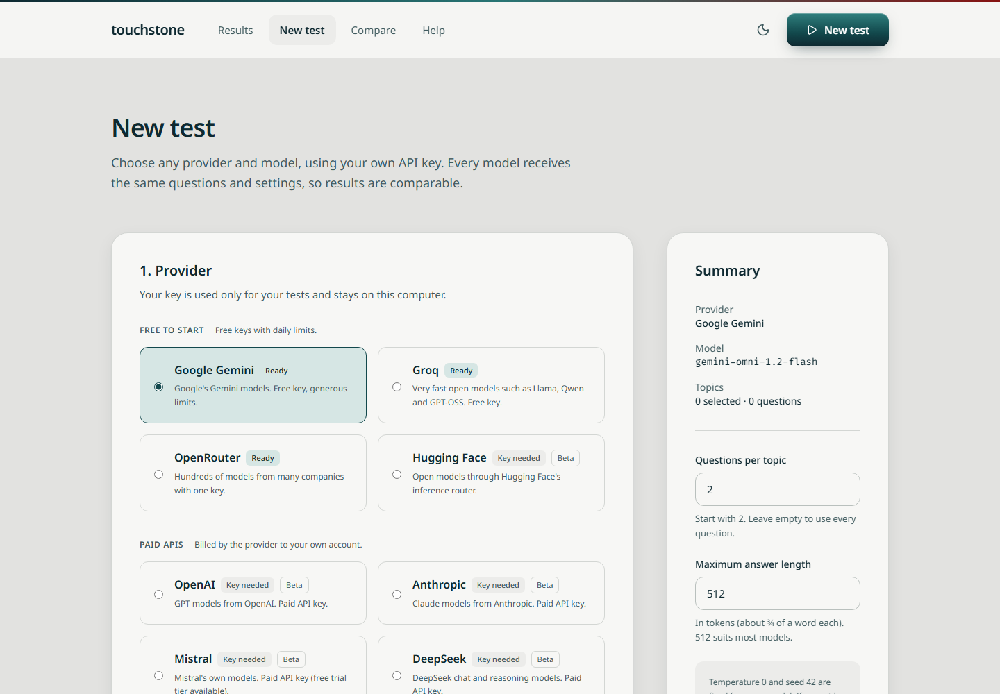
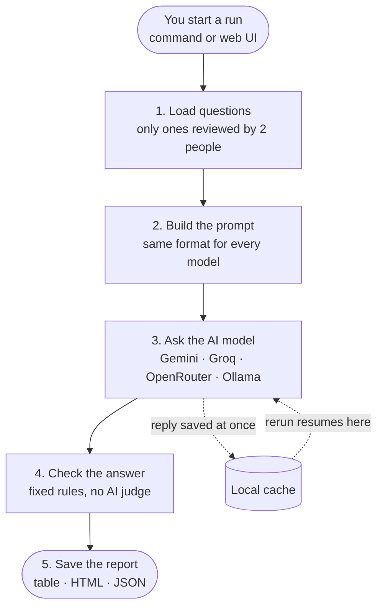
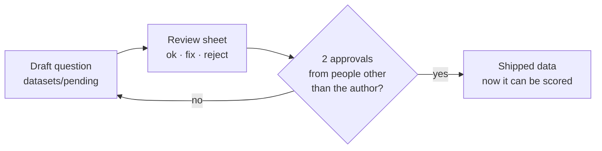
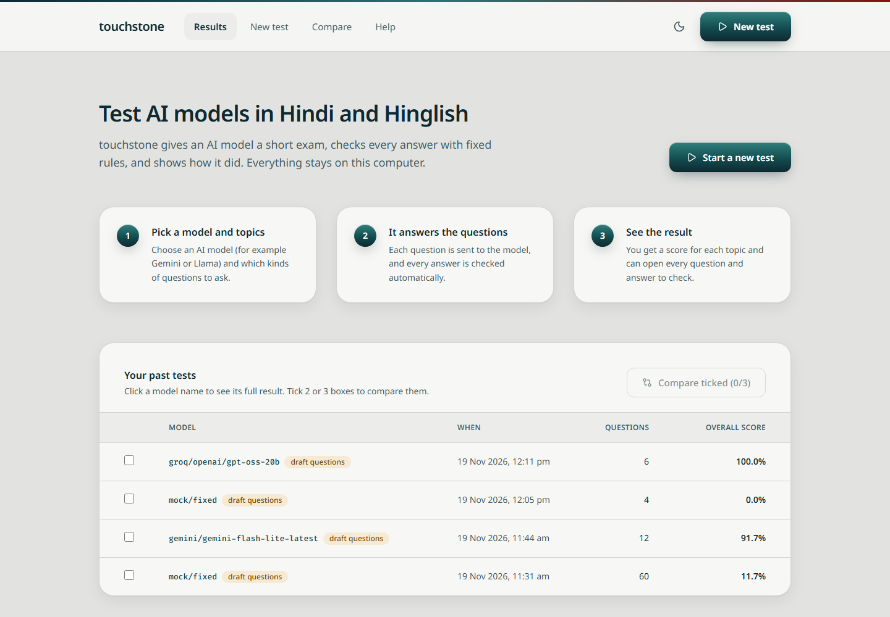

<div align="center">

# touchstone

**Find out how well any AI model understands Hindi and Hinglish.**<br>
Small, reproducible tests. One command. A clear report. Every prompt and reply saved.

```bash
python -m pip install "touchstone-llm[ui]"
python -m touchstone_llm ui
```

[](https://colab.research.google.com/github/harshita2012sharma-max/Touchstone/blob/main/notebooks/touchstone_colab.ipynb)
[](https://huggingface.co/spaces/20HARSHITA/touchstone)

[](https://github.com/harshita2012sharma-max/Touchstone/actions/workflows/ci.yml)
[](https://pepy.tech/project/touchstone-llm)
[](LICENSE)
[](pyproject.toml)
[](https://pypi.org/project/touchstone-llm/)
[](CHANGELOG.md)
[](DATASETS.md)



</div>

> [!NOTE]
> **Early release.** The questions are still being reviewed by people, so no official results are published yet. Everything else works today: test any model with your own key, in the browser, the terminal or Colab.

---

## What is this, in one picture?

A touchstone is the dark stone jewellers use to test gold. This project does the same for AI models: it gives them a small exam in Hindi and Hinglish and checks their answers.

| In an exam | In touchstone |
|---|---|
| Question paper | Our own written questions (the dataset) |
| Student | The AI model you choose (Gemini, Llama, Qwen, ...) |
| Teacher checking answers | Fixed scoring rules, no AI judge |
| Report card | A score table, an HTML report, and a JSON file with everything |

## How one test run works



<details>
<summary><b>What happens in each step? (click to open)</b></summary>

1. **Load questions.** Only questions approved by two reviewers (other than the author) are used. Drafts are never scored.
2. **Build the prompt.** Every model gets the exact same text and the same settings: temperature 0, seed 42, top_p 1.
3. **Ask the model.** Free APIs allow only a few requests a minute, so touchstone waits between calls and retries politely. Each reply is saved straight away, so if your internet or quota runs out, the same command continues where it stopped.
4. **Check the answer.** Multiple choice understands `B`, `(b)`, `Answer: B`, `उत्तर: B` and similar. If the model names two options or none, the answer is marked **unparsed** and counted wrong. Translation uses chrF. Instructions use rule checks.
5. **Save the report.** You get a table in the terminal and three files in `runs/`.

</details>

## Quickstart (2 steps)

You need [Python 3.10 or newer](https://www.python.org/downloads/). Nothing else. Open a terminal (on Windows: PowerShell) and run:

```bash
python -m pip install "touchstone-llm[ui]"
python -m touchstone_llm ui
```

Keep that terminal window open. Your browser opens at `http://127.0.0.1:7860` (if that port is busy, the terminal shows the address it used instead). Then:

1. Open **New test** and pick a provider. If it says "needs a key", click the link to get a free key, paste it into the box and press **Save key**.
2. Pick a model and tick some topics, then press **Start test**.
3. Watch the progress bar. The result opens by itself.

No key at all? Choose **Practice (mock)**, a pretend model that needs no key.

<details>
<summary><b>Something went wrong? (click to open)</b></summary>

| What you see | What to do |
|---|---|
| `python` is not recognized (Windows) | Use `py` instead of `python` in both commands, or install Python from python.org and tick **"Add python.exe to PATH"**. |
| `No matching distribution found for touchstone-llm` | Your Python is older than 3.10. Check with `python --version` and install a newer one. |
| Browser says "refused to connect" | The server is not running. Run `python -m touchstone_llm ui` again and keep the window open. |
| `touchstone` is not recognized | Normal on many Windows setups. Use `python -m touchstone_llm ui` (the short `touchstone` command only works if pip's Scripts folder is on PATH). |
| macOS/Linux says `pip` or `python` not found | Use `python3 -m pip install "touchstone-llm[ui]"` and `python3 -m touchstone_llm ui`. |

To update later: `python -m pip install -U "touchstone-llm[ui]"`.

</details>

> [!NOTE]
> The questions are still being reviewed, so tests use the **draft questions** that ship with touchstone and results are marked as practice runs. Please do not publish those numbers yet.

<details>
<summary><b>Using Google Colab? (click to open)</b></summary>

Fastest: open the ready-made notebook [](https://colab.research.google.com/github/harshita2012sharma-max/Touchstone/blob/main/notebooks/touchstone_colab.ipynb) and press **Runtime → Run all**.

Or, in any notebook: `touchstone ui` cannot be reached from Colab, so start the same web UI from a Python cell instead:

```python
!pip install -q "touchstone-llm[ui]"
from touchstone_llm.colab import launch
launch()
```

Click **Open touchstone**. The same UI opens in a new tab: pick a provider, paste your key, pick or type a model, press **Start test**. Nothing else to type in the notebook.

- The link is private: only the Google account running the notebook can open it.
- Keys you save live on the Colab machine and are wiped when the Colab session ends. Do not save keys inside the notebook itself if you share it.
- Results are saved in the `runs/` folder on the Colab machine; download them from the Files panel before the session ends.

</details>

<details>
<summary><b>Prefer the terminal? (click to open)</b></summary>

```bash
python -m touchstone_llm list-models groq                  # model ids change often, pick from the live list
python -m touchstone_llm run --model groq/<model-id> --tasks all --drafts --limit 2
python -m touchstone_llm run --model mock/fixed --tasks all --drafts   # practice, no key needed
python -m touchstone_llm reproduce runs/<result>.json      # rerun the exact same test
python -m touchstone_llm --help                            # every command
```

If the `touchstone` command works on your machine, you can use it as a shortcut, e.g. `touchstone run ...`.

Keys for the terminal can be saved once from the web UI, or put in a `.env` file (see `.env.example`), or set as environment variables.

</details>

<details>
<summary><b>Which providers and models can I test?</b></summary>

Any model from these providers, with **your own** API key. Pick from the live model list, or type the exact model name.

| Provider | Get your key | Notes |
|---|---|---|
| Google Gemini | [aistudio.google.com/apikey](https://aistudio.google.com/apikey) | Free tier |
| Groq | [console.groq.com/keys](https://console.groq.com/keys) | Free tier |
| OpenRouter | [openrouter.ai/keys](https://openrouter.ai/keys) | Hundreds of models; `:free` ones cost nothing |
| Hugging Face | [huggingface.co/settings/tokens](https://huggingface.co/settings/tokens) | Open models, free tier (beta) |
| OpenAI | [platform.openai.com/api-keys](https://platform.openai.com/api-keys) | Paid (beta) |
| Anthropic | [console.anthropic.com](https://console.anthropic.com/) | Paid (beta) |
| Mistral | [console.mistral.ai/api-keys](https://console.mistral.ai/api-keys) | Paid, trial tier (beta) |
| DeepSeek | [platform.deepseek.com/api_keys](https://platform.deepseek.com/api_keys) | Paid (beta) |
| xAI | [console.x.ai](https://console.x.ai/) | Paid (beta) |
| Together AI | [api.together.ai/settings/api-keys](https://api.together.ai/settings/api-keys) | Paid (beta) |
| Ollama | no key | Runs a model on your computer |
| **Custom server** | your own | Any OpenAI-compatible address: a company endpoint, LM Studio, vLLM, or another provider |

"Beta" means the request format is tested but has not yet been confirmed against the live service by the maintainers; please [open an issue](https://github.com/harshita2012sharma-max/Touchstone/issues) if something fails. If a provider rejects one of the fixed settings (some models refuse `temperature`, for example), touchstone sends the request without it and **records that in the result**.

Keys you paste in the web UI are stored only on your computer, in `~/.touchstone/.env`, and are sent only to the provider you chose. You can also use environment variables or a `.env` file (see `.env.example`). Never paste keys into issues or chats.

</details>

<details>
<summary><b>For contributors: run from the source code</b></summary>

You also need Node.js 20+ to build the web UI once.

```bash
git clone https://github.com/harshita2012sharma-max/Touchstone.git
cd Touchstone
python -m venv .venv
.venv/Scripts/activate            # macOS/Linux: source .venv/bin/activate
cd ui && npm ci && npm run build && cd ..
pip install -e ".[dev,ui]"
pytest
```

See [CONTRIBUTING.md](CONTRIBUTING.md).

</details>

## What it tests

Eleven tasks, from everyday reading to grammar, idioms and logic. Every task has hard items written to trip models up. Click a task to see a real example question.

<details>
<summary><b>hindi_comprehension</b>: read a short Hindi passage, answer a question</summary>

> **Passage:** मीना हर रविवार अपनी दादी के साथ बाज़ार जाती है। ...
> **Question:** मीना अपनी दादी के साथ बाज़ार कब जाती है?
> A. हर सोमवार · **B. हर रविवार** · C. हर शनिवार · D. हर दिन

Scoring: the chosen letter must match exactly.
</details>

<details>
<summary><b>hinglish_understanding</b>: understand Roman-script chat, including sarcasm</summary>

> **Message:** Kabir (bus chhootne ke baad): Wah, kya perfect timing hai meri!
> **Question:** Kabir asal mein kya keh raha hai?
> **A. Woh frustrated hai kyunki uski bus chhoot gayi** · B. Woh khush hai ki time pe pahuncha · ...

Scoring: the chosen letter must match exactly.
</details>

<details>
<summary><b>translation_hi_en</b>: translate Hindi into English</summary>

> **Hindi:** कृपया दरवाज़ा बंद कर दीजिए।
> **Accepted English:** "Please close the door." / "Please shut the door."

Scoring: chrF (character overlap with the best reference), from 0 to 100%.
</details>

<details>
<summary><b>codemixed_instructions</b>: follow a Hinglish instruction exactly</summary>

> **Instruction:** Teen Indian sweets ke naam batao, comma se alag karke. Sirf naam likhna, aur kuch nahi.

Scoring: rule checks (exactly 3 comma-separated items, at most 10 words). All rules must pass. Writing 5 sweets fails.
</details>

<details>
<summary><b>hindi_reasoning</b>: solve a word problem</summary>

> **Question:** एक कमीज़ की कीमत 800 रुपये है। उस पर 25 प्रतिशत की छूट मिल रही है। छूट के बाद कमीज़ कितने रुपये की पड़ेगी?
> **Answer:** 600

Scoring: the final number must match. Devanagari digits (६००) and Indian grouping (1,00,000) are understood.
</details>

<details>
<summary><b>cultural_context</b>: neutral facts about everyday India</summary>

> **Question:** इडली बनाने में मुख्य रूप से किन चीज़ों का इस्तेमाल होता है?
> A. गेहूँ और बेसन · B. मक्का और सूजी · C. जौ और चना · **D. चावल और उड़द दाल**

Only neutral facts: festivals, food, geography, institutions. No religion comparisons, caste, politics or stereotypes.
</details>

<details>
<summary><b>hindi_grammar</b>: agreement, case markers, संधि, समास, spelling</summary>

> **सीता ने तीन किताबें ___।** पढ़ा · पढ़ी · **पढ़ीं** · पढ़े

Scoring: the chosen letter must match exactly.
</details>

<details>
<summary><b>idioms_proverbs</b>: मुहावरे and लोकोक्तियाँ used in a sentence</summary>

> बीस लोगों के परिवार के लिए एक किलो चावल तो **'ऊँट के मुँह में जीरा'** है।
> **ज़रूरत से बहुत कम** · ऊँट को जीरा पसंद है · बहुत ज़्यादा · खाना बेकार जाना

Scoring: the chosen letter must match exactly.
</details>

<details>
<summary><b>hindi_logic</b>: family riddles, seating, calendars, directions, syllogisms</summary>

> सुबह सूरज उगने के कुछ देर बाद राजू की परछाईं ठीक उसके बाईं ओर पड़ रही है। राजू किस दिशा में मुँह करके खड़ा है? **उत्तर**

Scoring: the chosen letter must match exactly.
</details>

<details>
<summary><b>translation_en_hi</b>: translate English into Hindi</summary>

> **English:** No sooner had he left than it started raining.
> **Accepted Hindi:** "उसके निकलते ही बारिश शुरू हो गई।" / "जैसे ही वह गया, बारिश शुरू हो गई।"

Scoring: chrF against the references, from 0 to 100%.
</details>

<details>
<summary><b>hinglish_to_hindi</b>: rewrite Roman Hinglish as standard Devanagari Hindi</summary>

> **Hinglish:** Weather bahut pleasant hai, chalo walk pe chalte hain.
> **Accepted Hindi:** "मौसम बहुत सुहावना है, चलो टहलने चलते हैं।"

Scoring: chrF against the references, from 0 to 100%.
</details>

## How the questions are made

Trust in a benchmark starts with its questions. Every question goes through this path, and the code enforces it:



<details>
<summary><b>The rules every question follows</b></summary>

- Written for this project. Nothing is copied from exams, books or websites.
- Licensed **CC-BY-4.0**, so anyone can reuse it with credit.
- Approved by **at least two reviewers who are not the author**. The test suite fails if this is not true.
- Some first drafts were written with help from an AI assistant. A human author edits and fact-checks every item, and two humans review it. This is stated openly in [DATASETS.md](DATASETS.md).

Want to help review? See the [review guide](datasets/README.md). No coding needed, just a spreadsheet.

</details>

## How results stay fair

| Promise | How it is kept |
|---|---|
| Same test for every model | Fixed temperature 0, seed 42, top_p 1 and identical prompts. The CLI cannot change temperature or seed. |
| Nothing hidden | Every result saves the model you asked for, the model id the provider actually used, the date, settings, number of items, and every exact prompt and reply. |
| Anyone can check | `touchstone reproduce runs/<file>.json` reruns the same config and reports whether the prompts and settings match. |
| No hype | Reports show numbers, sample sizes and limitations. touchstone never names a "best" model, and ties are shown as ties. |

## Results

No official results yet. They will be published here only after every question has been reviewed, and each result will show the date, the model id, settings, the number of items and the prompts.



### Make your own leaderboard

Run several models, then turn the saved results into a ranked table and a chart you can share:

```bash
python -m touchstone_llm leaderboard runs/*.json
```

This writes `leaderboard/leaderboard.md` (a table for a README or blog), `leaderboard.json` and `leaderboard.svg` (an image for social posts). Only runs with the same settings and task versions are compared, the latest run of each model is used, equal scores share a rank, and sample sizes are always shown. If any run used draft questions, every file is stamped **PRACTICE, do not publish**.

## Limitations

> [!WARNING]
> Please read these before using any number from touchstone.
> - **Small dataset** (about 20 to 45 questions per task). A few points of difference is often noise.
> - **Hindi is not all of India.** Other Indian languages and many dialects are not covered.
> - **Hinglish has no standard spelling**, so rule-based scoring can miss valid answers.
> - **chrF is a rough signal** for translation and can penalise good paraphrases.
> - **API models change** behind the same name. Always check the date and the reported model id.
>
> Full list: [LIMITATIONS.md](LIMITATIONS.md).

## FAQ

<details>
<summary><b>Does it need a GPU or a powerful laptop?</b></summary>

No. It was built on an Intel i3 laptop with 8 GB RAM and no GPU. Models run on the provider's servers, or locally through Ollama if you use a small model.
</details>

<details>
<summary><b>Is it free?</b></summary>

touchstone itself is free and open source. Gemini, Groq and OpenRouter have free tiers (with limits), and Ollama is free and runs on your machine.
</details>

<details>
<summary><b>Are my API keys safe?</b></summary>

Keys are read only from your local `.env` file, which git ignores. touchstone never prints, logs or saves them, sends no telemetry, and the web UI only listens on `127.0.0.1`. See [SECURITY.md](SECURITY.md).
</details>

<details>
<summary><b>Why can the same model get different scores on different days?</b></summary>

Providers can update a model without changing its name, and some ignore the seed. That is why every result records the date and the exact model id the provider reported.
</details>

<details>
<summary><b>Can I add my own task or model provider?</b></summary>

Yes. Tasks and providers are plugins (`touchstone_llm.tasks` and `touchstone_llm.backends` entry points). See [CONTRIBUTING.md](CONTRIBUTING.md).
</details>

## Related work

touchstone is a small, laptop-first tool, not a replacement for these larger efforts. It shares no data or code with them.

- **MILU** (AI4Bharat and IBM Research India): multiple-choice Indic language understanding across 11 languages. Verma et al., NAACL 2025. [arXiv:2411.02538](https://arxiv.org/abs/2411.02538)
- **IndicGenBench** (Google Research India): generation tasks across 29 Indic languages. Singh et al., ACL 2024. [arXiv:2404.16816](https://arxiv.org/abs/2404.16816) · [code and data](https://github.com/google-research-datasets/indic-gen-bench)
- **indic_eval** (GitHub: adithya-s-k): an Indic LLM evaluation suite built on Hugging Face LightEval. [github.com/adithya-s-k/indic_eval](https://github.com/adithya-s-k/indic_eval). This project was first planned as "indic-eval" and renamed so the two are not confused.
- **HinglishEval**: code-generation models on Hinglish prompts, COMPUTE 2024. [github.com/mrigankpawagi/HinglishEval](https://github.com/mrigankpawagi/HinglishEval)

## Contributors

touchstone is created and maintained by [Harshita Sharma](https://github.com/harshita2012sharma-max).

Every merged contribution and every question reviewer is listed here. Want to be next? Reviewing questions needs no coding: [volunteer here](https://github.com/harshita2012sharma-max/Touchstone/issues/new?template=become_a_reviewer.yml), or see [CONTRIBUTING.md](CONTRIBUTING.md) for other ways to help.

| Who | What |
|---|---|
| [Harshita Sharma](https://github.com/harshita2012sharma-max) | Creator and maintainer |

## Cite, contribute, license

- **Cite:** use [CITATION.cff](CITATION.cff), or GitHub's "Cite this repository" button.
- **Contribute:** see [CONTRIBUTING.md](CONTRIBUTING.md) and the [Code of Conduct](CODE_OF_CONDUCT.md). Reviews from fluent Hindi and Hinglish speakers are the most valuable help right now.
- **License:** code under [Apache-2.0](LICENSE) (see also [NOTICE](NOTICE)), dataset items under CC-BY-4.0. Copyright 2026 Harshita Sharma and contributors.
